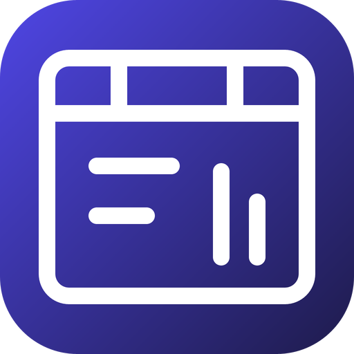

# go-ooxml — brand assets

Official logos for the **go-ooxml** organization.

## Formats

- **SVG** — `svg/color`, `svg/white` (white, transparent), `svg/black` (black, transparent)
- **PNG** 16→1024 px, 3 variants — `png/<variant>/<size>/`
- **JPG** (color, white background) — `jpg/<size>/`
- **ICO** (Windows) — `ico/`
- **ICNS** (macOS) — `icns/`
- **GitHub avatar** 512 px — `avatar/`
- **Social preview** 1280×640 (repo banner) — `social/`

## The mark

One container, three vocabularies — three parts across the top of a single
package, with a document's lines and a spreadsheet's bars inside it. That is
the thing worth knowing about OOXML, and the opposite of ODF, where one
vocabulary spans every kind of document.

⛔ **The colours are not chosen here.** `go-ooxml` joins the **document
family** — `go-odf`, `go-richdoc`, `go-rtf`, `go-docutils` — and takes its
gradient, `#4F46E5 → #1E1B4B`, along with the grammar every mark in that family
shares: a 256 px plate at `rx="56"`, and a white line glyph at
`stroke-width="12"` with round caps and joins.

Measured rather than remembered: across the 312 organisation marks there is no
single fleet-wide stroke width — 13 is the commonest and 10 appears once — so
the rule is the **family's** value and not the fleet's.

---
*Auto-generated assets — rounded square badge, line glyph, color / white / black variants.*
